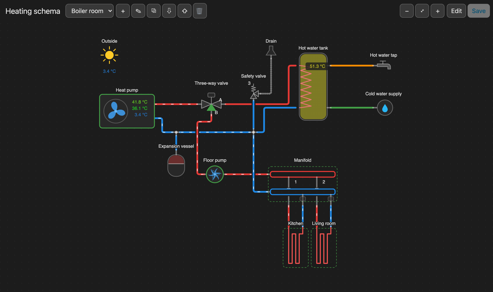
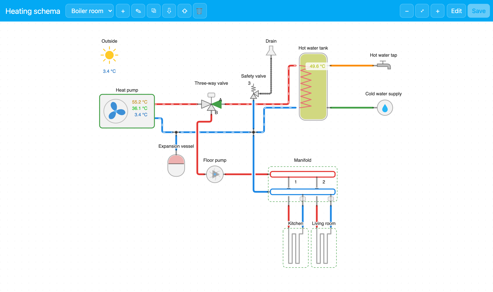
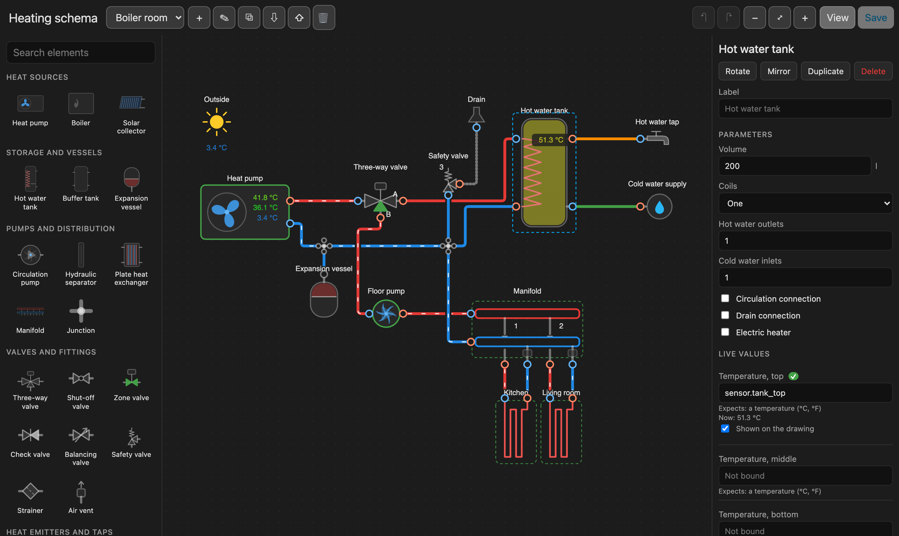
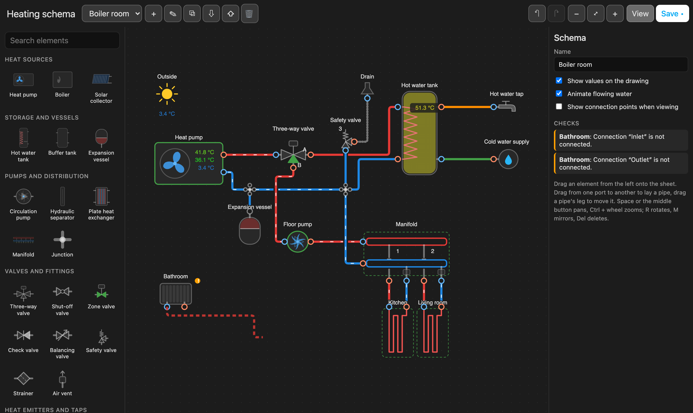
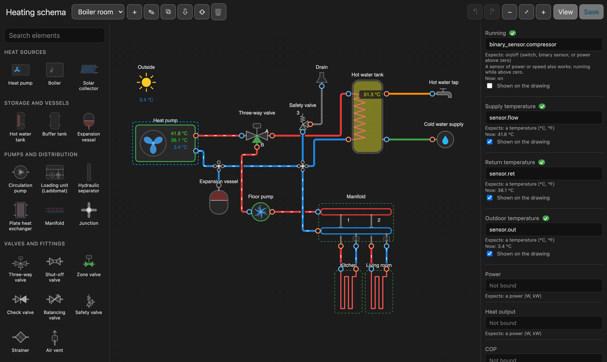
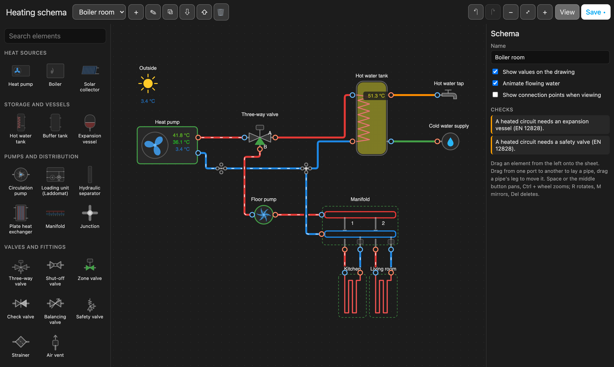
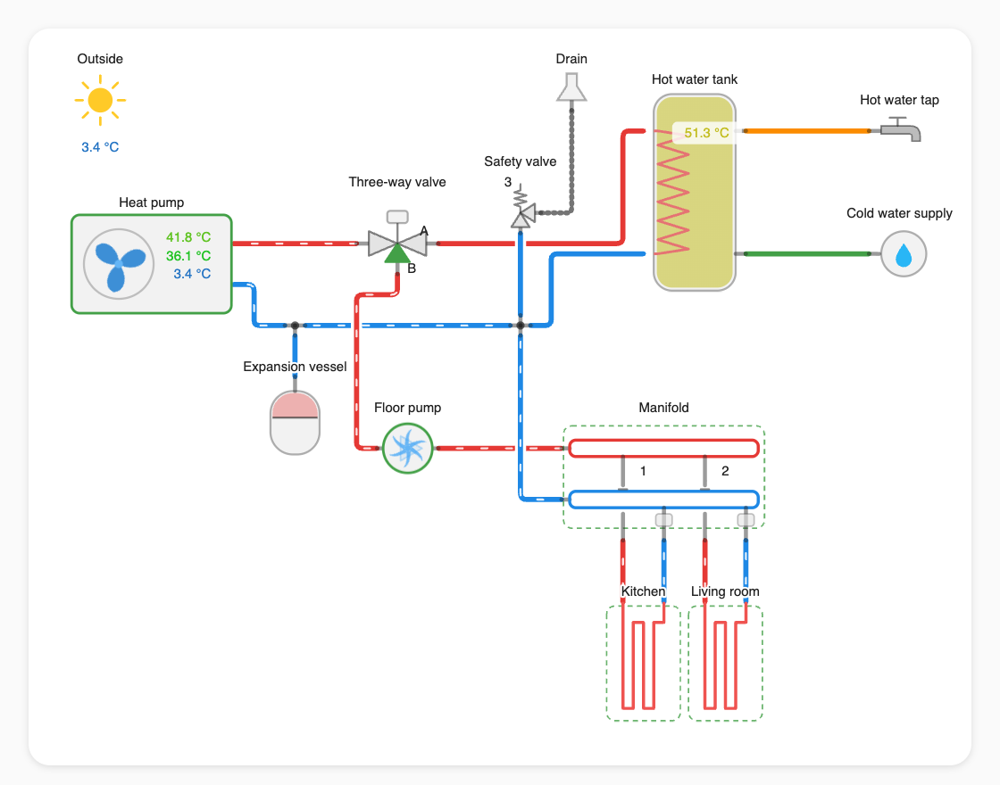
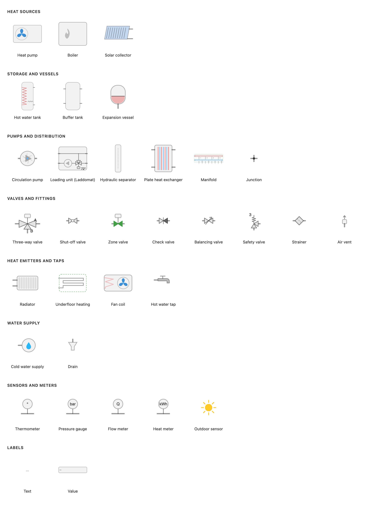

# Heating Schema

[](https://hacs.xyz/docs/faq/custom_repositories)
[](LICENSE)

Draw your heating system in Home Assistant and watch it work. Heat pumps and
boilers, tanks, pumps, valves, manifolds, radiators and underfloor heating,
with the water moving where the pumps push it and the temperatures shown where
the sensors sit.



- **An editor of its own, in the sidebar.** Drag elements from a palette, draw
  pipes from port to port, branch off a pipe by dropping onto it. Undo, copy
  and paste, and keyboard shortcuts are there too, and it works on a phone.
- **Technically sound.** Every connection knows its circuit: heating water,
  domestic hot water, cold water, solar fluid or brine.
  - Potable water cannot be piped into a heating circuit (EN 1717).
  - A supply joined to a return is flagged.
  - A heated circuit without an expansion vessel or a safety valve is pointed
    out (EN 12828).
- **Live, and only where it should be.** Water flows only through a loop
  that a running pump drives, past open valves. A three-way valve sends it one
  way or the other, and an open tap draws water from the mains through the
  tank.
- **Values of the right kind.** Each input expects a kind of entity, such as a
  temperature, a pressure, a flow or an on/off state. The editor offers
  matching entities first and warns about the rest.
- **A dashboard card** that shows a schema and follows every change made in
  the panel, without a reload.
- **Light and dark themes.** It follows Home Assistant's theme.
- **Languages:** English and Ukrainian.



## Installation

### HACS

1. In HACS, open the menu (⋮) → **Custom repositories**.
2. Add `https://github.com/Moxnatiy/hass-heating-schema` with type
   **Integration**.
3. Find **Heating Schema** in HACS, download it, and restart Home Assistant.

### Manually

Copy `custom_components/heating_schema` into the `custom_components` folder of
your Home Assistant configuration, then restart Home Assistant.

### Set it up

**Settings → Devices & services → Add integration → Heating Schema.** A
**Heating schema** panel appears in the sidebar. Its name and icon can be
changed under the integration's **Configure**.

## Drawing your first schema

Everyone can look at a schema. Only administrators can change one.

### 1. Create a schema

In the panel, press **+** and give the schema a name. A new schema opens in
edit mode. The buttons next to the name rename, duplicate, export, import and
delete schemas; a schema exports as a JSON file.

### 2. Place elements

Drag an element from the palette on the left onto the sheet, or click it to
drop it in the middle. Use the search field at the top of the palette to find
an element by name.

- **Select** an element by clicking it. Shift+click adds to the selection, and
  a frame dragged over the empty sheet selects everything inside it.
- **Move** the selection by dragging it or with the arrow keys.
- **Rotate** with **R**, **mirror** left to right with **M** or top to bottom
  with **Shift+M**, make it **larger or smaller** with **+** and **−**
  (50 % to 200 %). The same tools are the icons at the top of the inspector.



The inspector on the right holds the selected element's label and parameters.
What the parameters change depends on the element. Some examples:

- **Hot water tank:** one, two or three coils; up to three hot water outlets
  and up to three cold inlets, each set beside its main connection; the hot
  water on the side or on top, the cold on the side or underneath; a
  circulation return, a drain connection and an electric heater.
- **Manifold:** the number of loops; the heating water fed from the left, the
  right or both ends; all connections pointing down, the supplies up and the
  returns down, or pairs on both sides, which halves the manifold's length.
- **Loading unit:** four connections, through to the tank (Laddomat 21), or
  three, the bypass only, with a tee to the tank outside (ESBE LTC); the
  thermostat's opening temperature.
- **Pump:** how it is controlled, and whether its impeller or its triangle
  turns while it runs.
- **Radiator:** side, cross or bottom connection.
- **Heated towel rail:** bottom, side or cross connection; on the heating or
  on the hot water circulation; an electric heater, so it warms in summer too.
- **Lines and shapes:** length, or width and height; solid, dashed, dotted or
  dash-dot; thickness, colour, arrows at the ends of a line, rounded corners
  for a frame and a light fill for a shape. Drawings lie under the pipes and
  are grabbed on their lines only, so a frame drawn around a boiler room
  never gets in the way of what is inside it. A drawing shows its name only
  when given one.

### 3. Draw pipes

Press on a connection point (a small circle) and drag to another one. While
you drag, the preview tells you whether the two may be joined:

- **solid:** fine;
- **amber:** allowed, but probably a mistake, such as a supply into a return;
- **red:** refused, such as potable water into a heating circuit.

Drop onto the middle of an existing pipe to branch off it with a tee.



Pipes are routed at right angles and go around the elements they join. To
change a route, select the pipe and drag any of its straight legs. Also in the
inspector:

- the pipe's medium, which sets its colour: red for heating supply, blue for
  heating return, orange for hot water, green for cold water, violet for
  circulation, and colours of their own for solar fluid, brine and drains;
- its size (DN);
- a label.

### 4. Connect live values

Each element lists the values it can show under **Live values**, such as a
heat pump's running state, its supply, return and outdoor temperatures, its
power and its COP. Type or pick an entity for each one.

- A click on the field opens a large search in the middle of the screen, like
  Home Assistant's quick search: names, ids, devices and areas are shown
  whole, with icons and current values, and arrows and Enter pick one. It
  offers the entities of the expected kind; untick "Only entities that fit"
  to see all of them, or type any entity id to use it.
- A ✓ shows that the entity fits, and a warning shows that it does not.
- The current value is shown under the field.
- **Shown on the drawing** decides whether the value appears on the schema.



What the values do:

- **Pumps** run and turn while their *running* entity is on. Instead of an
  on/off entity, a power or speed sensor also works: the pump runs while it
  is above zero. A *speed* in percent makes the pump turn and the water flow
  faster.
- **Heat sources** with a built-in pump drive their circuit themselves.
- **Three-way valves** follow an on/off entity (path A or B) or a position in
  percent.
- **Zone and shut-off valves, and manifold loops,** open and close.
- **Taps** draw water while their flow or open entity says so.
- **Tanks** colour their water by their temperatures, top to bottom.

### 5. Check and save

With nothing selected, the inspector shows the schema's settings and its
**Checks**: unconnected connections, mixed circuits, and a heated circuit
that has no expansion vessel or safety valve. Click a problem to select the
element it is about.



Press **Save** (or Ctrl+S). Every open panel and card shows the change at
once. **View** leaves edit mode. In view mode, clicking an element opens its
entity's details.

### 6. Put it on a dashboard

Edit a dashboard, add a card and pick **Heating schema** from the list, then
choose the schema. Or in YAML:

```yaml
type: custom:heating-schema-card
schema_id: 1a2b3c4d5e6f   # the card editor lists your schemas
height: 400               # optional; without it the card keeps the drawing's proportions
```



## Elements



| Group | Elements |
| --- | --- |
| Heat sources | heat pump, boiler (gas, oil, pellet, solid fuel, electric), solar collector |
| Storage | hot water tank, buffer tank, expansion vessel |
| Pumps and distribution | circulation pump, boiler loading unit (of the Laddomat 21 kind), hydraulic separator, plate heat exchanger, manifold, junction |
| Valves and fittings | three-way valve, shut-off valve, zone valve, check valve, balancing valve, safety valve, strainer, air vent |
| Heat emitters and taps | radiator, underfloor heating loop, fan coil, heated towel rail, hot water tap |
| Water supply | cold water supply, drain |
| Sensors and meters | thermometer, pressure gauge, flow meter, heat meter, outdoor sensor |
| Labels | text, live value |
| Drawing | line, dashed line, arrow, frame, circle or ellipse, triangle |

## Keyboard shortcuts

| Keys | Action |
| --- | --- |
| Delete, Backspace | delete the selection |
| R / Shift+R | rotate clockwise / anticlockwise |
| M / Shift+M | mirror left to right / top to bottom |
| + / − | larger / smaller |
| Arrows (with Shift) | move by one grid step (by five) |
| Ctrl+Z, Ctrl+Shift+Z or Ctrl+Y | undo, redo |
| Ctrl+C, Ctrl+V, Ctrl+D | copy, paste, duplicate |
| Ctrl+A | select everything |
| Ctrl+S | save |
| Escape | cancel a drag, then clear the selection |
| Space + drag, middle button | pan |
| Ctrl + wheel, pinch | zoom |

On a Mac, use Cmd instead of Ctrl.

## How it is stored

Schemas live in Home Assistant's own storage (`.storage/heating_schema.schemas`) and
are part of your backups. Nothing leaves your Home Assistant. The integration
creates no entities: it only reads the ones you connect.

## Development

The frontend is plain ES modules with no build step.

```bash
node --test tests/frontend/*.test.mjs   # the frontend: elements, routing, flow, translations
pytest                                  # the backend, with pytest-homeassistant-custom-component
python3 tools/dev/serve.py              # the dev bench: the panel with a fake Home Assistant
node tools/dev/screenshots.mjs          # regenerates the pictures in docs/images
```

[docs/architecture.md](docs/architecture.md) explains how it is built and how
to add an element.

## License

[MIT](LICENSE)
